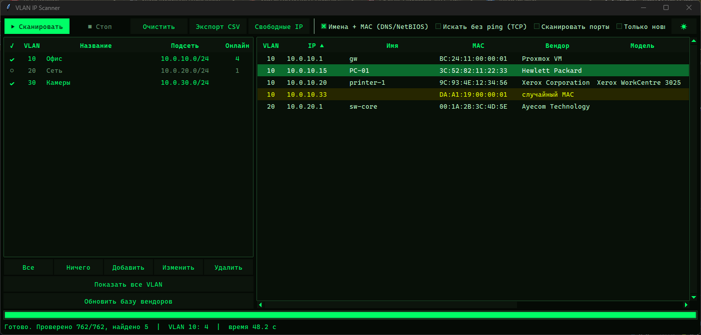
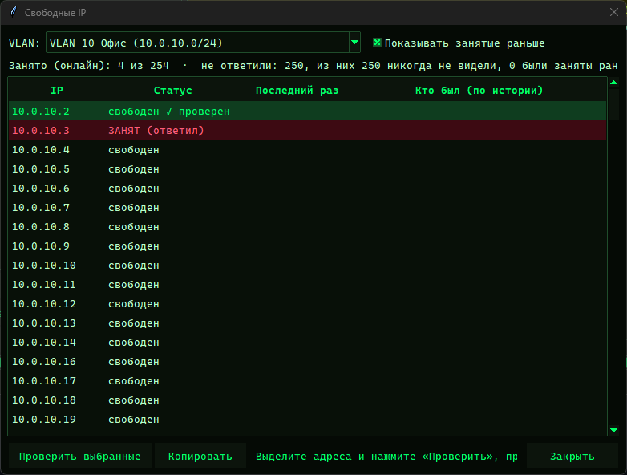
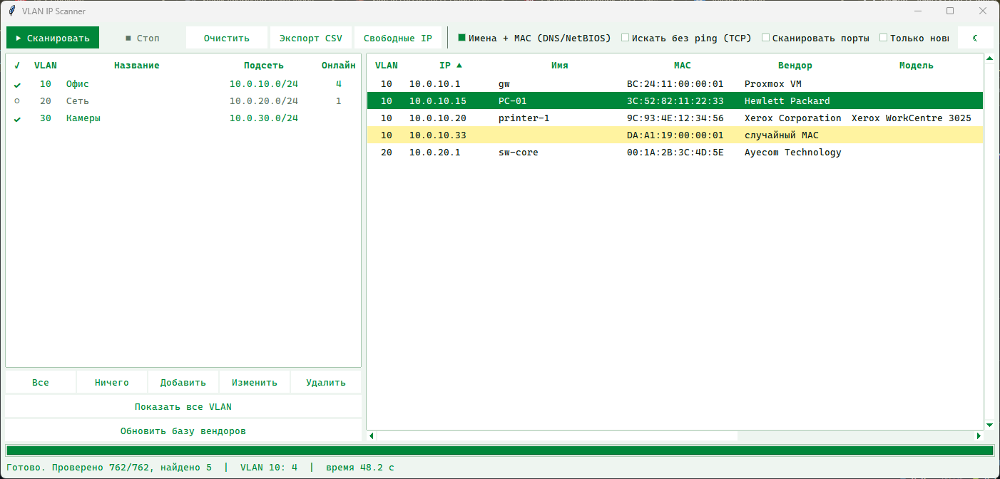

# VLAN IP Scanner

[English](README.md) · **Русский**

Программа для Windows, которая сканирует корпоративную сеть по VLAN и показывает все живые устройства: имя, MAC, производителя, модель, ОС и открытые порты. Ещё она находит свободные IP-адреса, подсвечивает новые устройства и выгружает результаты в CSV.

Только стандартная библиотека Python (интерфейс на tkinter), без зависимостей. Собирается в один `.exe`, которому Python не нужен.



## Возможности

- **Список VLAN**: добавить, изменить, удалить VLAN и его подсеть. Галочка ✓ включает VLAN в скан, клик по строкам фильтрует таблицу хостов.
- **Быстрый фоновый скан**: по умолчанию 128 потоков, сеть /24 проходит за секунды. Окно не зависает, **Стоп** останавливает сразу.
- **Поиск устройств**: ping с повторной проверкой тех, кто не ответил с первого раза (спящие принтеры, Wi-Fi-телефоны). По желанию TCP-поиск находит устройства, которые блокируют ping.
- **Данные об устройстве**:
  - **имя**: обратный DNS, NetBIOS или SNMP;
  - **MAC и производитель**: база IEEE OUI плюс встроенные префиксы Proxmox, VMware, Hyper-V и QEMU; случайные MAC помечаются;
  - **модель устройства**: SNMP или веб-страница устройства;
  - **ОС**: Windows, Linux/Unix, принтер, сетевое устройство, Proxmox;
  - **открытые порты**: 20 популярных портов.
- **Новые устройства**: по истории сканов видно, какие хосты появились с прошлого раза, они подсвечиваются.
- **Свободные IP**: адреса, которые не ответили. Отдельно помечены адреса, которые раньше были заняты (устройство может быть просто выключено). Кнопка **«Проверить выбранные»** перепроверяет адрес прямо перед выдачей.
- **Меню по правой кнопке**: копировать IP или строки, RDP, SSH, открыть `\\IP`, http/https, веб-интерфейс Proxmox (:8006), `ping -t`, пересканировать с портами.
- **Экспорт CSV**: UTF-8 с BOM и разделителем `;`, открывается в русском Excel без кракозябр.
- **Темы**: тёмная неоновая «Матрица» и светлая, переключение кнопкой ☀/☾.

| Свободные IP | Светлая тема |
| --- | --- |
|  |  |

## Как это работает

| Что | Как |
| --- | --- |
| Жив ли хост | `ping -n 1 -w 700`, живым считается только ответ с `TTL=` от самого IP; один повтор с увеличенным таймаутом |
| Без ping | TCP-подключение к 445, 135, 3389, 22, 80, 443, 8006, 9100 (считается и открытый порт, и RST) |
| Имя | обратный DNS, NetBIOS NBSTAT (UDP/137), SNMP `sysName` |
| MAC | свои интерфейсы, NetBIOS, `arp -a` (свой VLAN), SNMP `ifPhysAddress` (работает через маршрутизатор) |
| Производитель | база IEEE `oui.csv` + встроенные префиксы виртуализации |
| Модель | SNMP `sysDescr` (v1, затем v2c), заголовок веб-страницы и `Server` |
| ОС | по открытым портам и TTL |
| Порты | 21, 22, 23, 53, 80, 135, 139, 443, 445, 515, 631, 1433, 3306, 3389, 5900, 8006, 8080, 8443, 9100, 10050 |

## Как начать

### Запуск exe

1. Соберите его (см. ниже) или скачайте `VLAN-Scanner.exe` из Releases, если он там опубликован.
2. Положите в любую папку и запустите. Настройки и история сохраняются рядом с exe.
3. Один раз нажмите **«Обновить базу вендоров»**, чтобы скачать список производителей IEEE (~4 МБ).
4. Добавьте свои VLAN (**«Добавить»**), отметьте галочкой и нажмите **«▶ Сканировать»**.

### Запуск из исходников

Нужно: Windows 10/11, Python 3.9+ (проверено на 3.12).

```bat
git clone https://github.com/Temi1817/ip-scanner.git
cd ip-scanner
python vlan_scanner.py
```

### Сборка exe

```bat
build_exe.bat
```

Скрипт установит PyInstaller и соберёт `dist\VLAN-Scanner.exe` (один файл, без консоли).

## Настройки

При первом запуске программа создаёт рядом с собой `config.json` из встроенных значений. Пример со всеми настройками — в [`config.example.json`](config.example.json). Большая часть меняется в окне программы, а эти можно поправить вручную:

| Ключ | По умолчанию | Что значит |
| --- | --- | --- |
| `threads` | 128 | число параллельных проверок |
| `ping_timeout_ms` | 700 | таймаут ping |
| `ping_retries` | 1 | повторы для не ответивших (`0` — без повторов) |
| `tcp_timeout` / `port_timeout` | 0.5 / 0.8 | таймаут TCP-поиска / скана портов, секунды |
| `snmp_community` | `public` | SNMP community |
| `ssh_user` | пусто | пользователь для пункта меню SSH (`user@ip`) |
| `theme` | `dark` | `dark` или `light` |

## Файлы

| Файл | Что в нём |
| --- | --- |
| `vlan_scanner.py` | главное окно, точка входа |
| `scancore.py` | ping, TCP, NetBIOS, DNS, ARP, производители, ОС, конфиг, история, поток сканера |
| `devinfo.py` | SNMP v1/v2c и HTTP: имя, модель, MAC устройства |
| `freeip.py` | окно «Свободные IP» |
| `theme.py` | тёмная и светлая темы |
| `config.json`, `history.json`, `oui.csv` | создаются при работе рядом с программой, в репозитории их нет |

## Приватность

Всё остаётся на вашем компьютере. Результаты сканов, названия VLAN и история хранятся только в `config.json` и `history.json` рядом с программой, а `.gitignore` не пускает их в git. Единственный запрос в интернет — необязательное скачивание базы производителей с `standards-oui.ieee.org`.

## Важно

Сканируйте только сети, которые принадлежат вам или которые вы администрируете.
